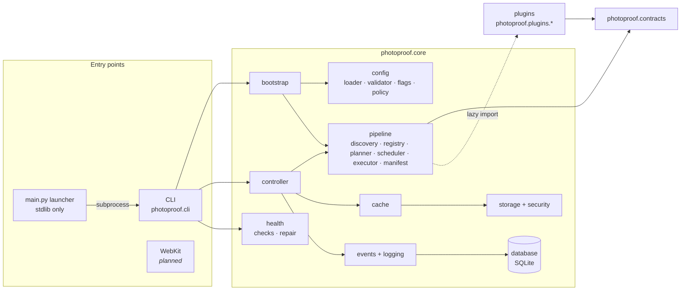

# Architecture overview

PhotoProof is a single Python process. The foundation deliberately avoids
distributed infrastructure: one SQLite database, local storage, in-process events,
and a sequential executor behind an interface that a process-isolated executor can
replace later.

## Components



| Component | Responsibility | Module |
|---|---|---|
| Launcher | Validate interpreter, OS, hardware; create `.venv`; install locked dependencies; preflight; start CLI | `main.py` |
| Contracts | Stable types shared by everything: analysis request/result, plugin metadata and context, artifacts, events, enums, exceptions | `photoproof.contracts` |
| Bootstrap | Load and validate configuration, discover plugins, wire services; no disk writes | `core/bootstrap.py` |
| Config | Parse `app.toml`/YAML safely, typed validation, feature flags, plugin policy precedence | `core/config/` |
| Pipeline | Discover → register → plan (DAG) → execute → manifest | `core/pipeline/` |
| Controller | Orchestrates one analysis run; knows nothing about individual algorithms | `core/controller.py` |
| Storage | `ARE/` layout, safe paths, atomic writes, content-addressed blobs, temp files | `core/storage/`, `core/security/` |
| Database | SQLite schema, migrations, transactions; the only place SQL lives | `core/database/` |
| Cache | Run-level result cache keyed by every result-affecting identity | `core/cache/` |
| Events and logging | Typed event bus, structured JSON log, audit trail, persistence subscriber | `core/events/`, `core/logging/` |
| Health | Diagnostics with severity and repairability; safe and controlled repair | `core/health/` |
| Imaging | Format detection, decoder registry, decoder security interface, Pillow decoder | `photoproof.imaging` |

## Dependency direction

```
UI / CLI  →  core  →  contracts
plugins   →  contracts
```

`contracts` imports nothing from `core`. Plugins import only from `contracts` and
receive everything else through `PluginContext`. The scheduler never needs to know
what a plugin computes.

## Image pipeline (planned wiring)

`bytes → detect_format → PillowDecoder → DecodedImage → normalize → WorkingImage`

These steps exist as separate, tested functions. `analyze` does not call the decoder or
`normalize` yet: #12 connects them, and #9 moves decoding into an isolated process. Normalizing
never changes the `DecodedImage`, so unconverted pixels stay available.

High-depth sources also have `normalize_hdr → WorkingImage` with `uint16` code values, plus their
transfer function and primaries. Values are stored as `uint16` because `float32` costs twice the
memory and rounds the low-amplitude noise that detectors look for.

## Data flow of one analysis

1. The CLI stores the input in the evidence store (streamed, size-limited) and builds an
   `InputDescriptor` from the record.
2. The controller resolves the profile and validates the mode (single vs comparison).
3. An optional `--ignore-blacklist` override is authorized (local CLI origin only) and
   audited.
4. Policy decides every plugin (see [precedence](../configuration/policy.md)).
5. The planner validates the graph and produces an ordered plan, or a **blocked** plan.
6. The run is created (`RUN_CREATED` → persisted).
7. If cached and valid, results are reused; otherwise the executor runs plugins.
8. Artifacts of successful plugins are recorded; completed runs are cached.
9. A deterministic manifest is written to `ARE/manifests/<run_id>.json`.
10. `RUN_COMPLETED`/`RUN_ABORTED` finalizes the database record.

Continue with the [execution lifecycle](lifecycle.md).
