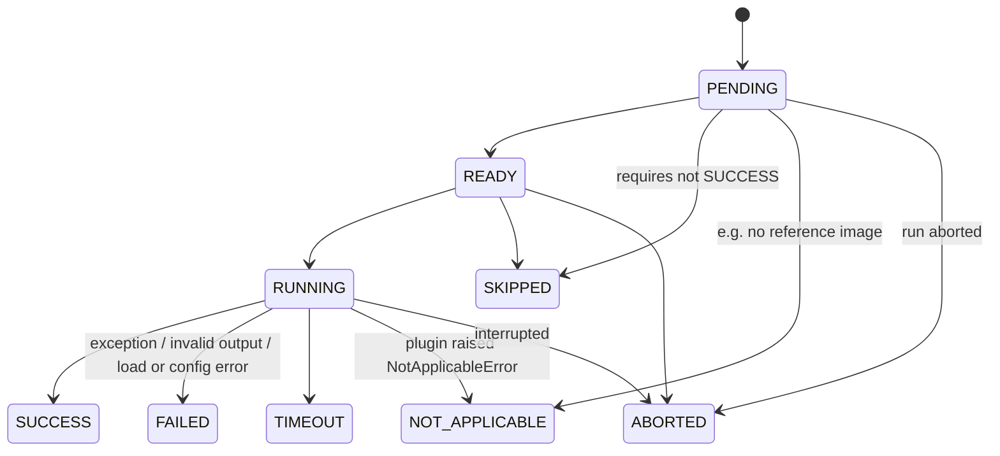

# Execution lifecycle and failure handling

## Planning

The planner (`core/pipeline/planner.py`) works in two stages.

**1. Graph validation (whole registry, enabled or not).** A `PlanningError` aborts
the request when:

- a `requires` dependency does not exist;
- the graph contains a cycle (through `requires` or `after`);
- a dependency has a *later* priority than its dependent (priority inversion);
- an input contract is neither a run input (`input.target`, `input.reference`) nor
  an output of a plugin listed in `requires`;
- two plugins declare the same output contract;
- a profile enables/disables an unknown plugin.

**2. Policy application.** Disabled and unavailable plugins are excluded. The plan is
**blocked** (status `BLOCKED`, nothing runs) when:

- a required plugin (`required: true` or listed in the profile's `required_plugins`)
  is disabled, blacklisted, forbidden or unavailable — the blacklist wins over
  `required`, but the run is never presented as complete;
- a required plugin would be skipped because its own `requires` chain is not planned;
- `dependencies.on_unavailable_requirement: block` and any plugin's `requires` is not
  planned;
- a profile's `required_outputs` cannot be produced.

## Ordering

Kahn's topological sort with a min-heap keyed on `(priority, discovery_index)`:

- lower priority values run earlier (0 initialization, 10 analysis, 20 secondary,
  30 verification, 90 fusion, 100 localization — conventions, not limits);
- ties keep deterministic discovery order (sorted package names);
- because a dependency can never have a later priority, the order is non-decreasing in
  priority, so `ExecutionPlan.stages` are exactly the priority barriers. With
  `scheduling.strict_priority_barriers: true` a future parallel executor must finish a
  stage before starting the next; the sequential executor satisfies this trivially.

**Conflict rule:** if a dependency's priority is higher than its dependent's, the
planner rejects the graph rather than silently reordering.

## Dependency semantics

| Field | Meaning |
|---|---|
| `requires` | Must finish `SUCCESS`. Otherwise the dependent is `SKIPPED` (`dependency_unavailable`). Its outputs may be consumed as inputs. |
| `after` | Ordering only. Must reach any terminal state first. Missing `after` targets are ignored. |
| `required` | If the plugin does not end `SUCCESS`, apply `failure_policy.on_required_failure`. |

## State machine

Illegal transitions raise `InvalidTransitionError`. Terminal states are final.

## Failure handling

- Every plugin call is isolated: exceptions become `FAILED` with category, exception
  type, traceback (truncated), start/end timestamps and the status of each dependency.
- Outputs must match the declared `outputs` exactly and be JSON-serializable (an
  `ArtifactRef` is allowed and normalized to `{"artifact": {...}}`); otherwise
  `FAILED` / `invalid_output`.
- Timeouts (`timeout_seconds` or `scheduling.default_plugin_timeout_seconds`) mark the
  plugin `TIMEOUT`. **Limitation:** the in-process thread cannot be killed and keeps
  running in the background; its late artifacts are never attached to the run.
  Process isolation is planned.
- Ctrl-C (or a plugin raising `KeyboardInterrupt`) aborts the run: the current plugin
  and all remaining ones become `ABORTED` (`interrupted`).
- Required-plugin failure: `abort` marks all remaining plugins `ABORTED`
  (`aborted_by_policy`); `degrade` continues and the run ends `INCOMPLETE`.
- A failing **critical** event subscriber (state persistence, audit trail) raises
  `EventDeliveryError` — it is never treated as a plugin failure.

## Run status

| Status | Meaning |
|---|---|
| `COMPLETED` | All planned plugins succeeded (optional plugins may be `NOT_APPLICABLE`). |
| `INCOMPLETE` | Finished, but some plugin failed, timed out or was skipped. Evidence is partial. |
| `ABORTED` | Stopped early. |
| `BLOCKED` | Policy left the profile unable to operate. Nothing ran. |
| `NO_DETECTORS` | No plugin is installed and enabled. |

!!! danger "A missing result is never evidence of authenticity"
    None of these statuses is a verdict. `NO_DETECTORS`, `INCOMPLETE` and `BLOCKED`
    say nothing about whether an image is authentic.
