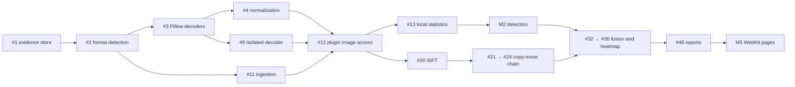

# Roadmap

Everything on this page is **planned**, not implemented. The authoritative,
fully specified work items are the [GitHub issues](https://github.com/satvikp-coder/PhotoProof/issues),
generated from `docs/planning/backlog/*.md` and indexed on the [backlog page](backlog.md).

## Milestones

| Milestone | Goal | Issues |
|---|---|---|
| M1 · Secure Image Ingestion | Immutable evidence store, format detection, safe and isolated decoding, normalized working images exposed to plugins | 12 |
| M2 · Classical Forensic Detection | Metadata, compression (ELA, DCT, grid), noise, copy-move chain, sharpness and edge detectors | 14 |
| M3 · Reference Image Comparison | Comparison requests, registration, SSIM difference maps, change masks, reporting | 5 |
| M4 · Localization and Evidence Fusion | Score normalization, rule-based fusion, inconclusive logic, segmentation, heatmaps, calibration | 6 |
| M5 · Web Application and Reporting | WebKit shell and pages, structured and PDF reports, manifest and diagnostics tooling | 12 |
| M6 · Security, Evaluation and Performance | Jobs and workers, process isolation, retention and privacy, fuzzing, backups, datasets, benchmarks | 20 |
| M7 · Research Extensions | Optional TruFor integration and dense block matching | 2 |

Milestones are delivery targets, not dates. Issues inside a milestone can proceed in
parallel once their dependencies (shown as native GitHub "blocked by" links) are merged.

## Critical path

**Next recommended issue: [#1](https://github.com/satvikp-coder/PhotoProof/issues/1)
(evidence store).** It has no dependencies, builds directly on `RuntimeStorage.put_blob`,
and unblocks the whole ingestion chain. In parallel, contributors can take
[#66](https://github.com/satvikp-coder/PhotoProof/issues/66) (metrics harness),
[#62](https://github.com/satvikp-coder/PhotoProof/issues/62) (database backups),
[#48](https://github.com/satvikp-coder/PhotoProof/issues/48) and
[#49](https://github.com/satvikp-coder/PhotoProof/issues/49) (manifest and diagnostic tooling),
and [#38](https://github.com/satvikp-coder/PhotoProof/issues/38) (WebKit framework decision),
none of which depend on decoding. An admin should do
[#63](https://github.com/satvikp-coder/PhotoProof/issues/63) (branch protection) first.

## Planned forensic techniques

| Family | Technique | Issue | Strength in fusion |
|---|---|---|---|
| Metadata | EXIF/XMP inconsistency findings | #14 | weak |
| Compression | Error Level Analysis (supporting only) | #15 | weak |
| Compression | Quantization tables, DCT double compression | #16 | medium |
| Compression | 8×8 grid misalignment | #17 | weak–medium |
| Noise | Wavelet residual, local MAD variance, consistency map | #18, #19 | medium |
| Geometry | SIFT → g2NN → clustering → RANSAC → ZNCC masks | #20–#24 | strong (verified) |
| Visual | Laplacian sharpness; Sobel/Canny edge profiles | #25, #26 | weak |
| Comparison | Registration, SSIM, change masks | #28–#30 | confirmed differences |
| Research | TruFor; dense block matching | #70, #71 | research only |

No technique is ever reported as proof on its own. Fusion (#33) documents how families
combine, and the assessment (#34) yields `inconclusive` whenever coverage is
insufficient. There is no "authentic" result category.

## Planned image format support

| Format | Decoder | Issue | Default |
|---|---|---|---|
| JPEG, PNG, WebP | Pillow | #3 | accepted |
| HEIF/HEIC | pillow-heif (libheif) | #6 | after isolation (#9) |
| JPEG XL | libjxl binding | #7 | opt-in |
| AVIF | Pillow / libavif | #8 | opt-in |
| TIFF (first page, restricted) | Pillow / libtiff | #8 | opt-in |

High bit depth and HDR representations are specified in #5, and cross-format
consistency is tested in #69.

## Benchmark strategy

1. Metric harness with hand-verified IoU, F1 and MCC, bootstrap CIs, and failed
   predictions reported separately (#66).
2. Datasets loaded from local copies only, after licence review: CoMoFoD (#64),
   COVERAGE, CASIA v2, MICC-F220 (#65). Nothing is redistributed.
3. Baselines before targets: copy-move (#67) and false positives and robustness (#68).
   No accuracy threshold is set before a baseline exists.
4. Calibration on validation splits grouped by source image, reported on test (#37).

## Future architecture enhancements

| Enhancement | Issue | Notes |
|---|---|---|
| Isolated decoder worker | #9 | Resource limits, crash containment |
| Worker hardening (seccomp, Landlock, AppContainer) | #59 | Per-platform capability matrix |
| Process-isolated executor | #52 | Same `Executor` protocol; makes timeouts enforceable |
| Durable SQLite job queue and supervised workers | #50, #51 | No message broker |
| Per-plugin content-addressed cache | #53 | Merkle keys along the DAG |
| Retention, quotas, privacy controls | #55, #56 | Evidence never deleted implicitly |
| Replay and environment restoration | #54 | Verify, then optionally restore |
| Resource metrics and profiling | #57 | Measure before optimizing |

Distributed infrastructure (Kubernetes, brokers, multiple databases) is out of scope
unless a demonstrated requirement appears.
