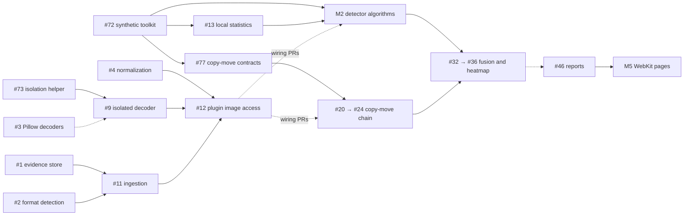

# Roadmap

Everything on this page is **planned**, not implemented. The authoritative,
fully specified work items are the [GitHub issues](https://github.com/satvikp-coder/PhotoProof/issues),
generated from `docs/planning/backlog/*.md` and indexed on the [backlog page](backlog.md).

## Milestones

| Milestone | Goal | Issues |
|---|---|---|
| M1 · Secure Image Ingestion | Immutable evidence store, format detection, safe and isolated decoding, synthetic test toolkit, normalized working images exposed to plugins | 14 |
| M2 · Classical Forensic Detection | Metadata, compression (ELA, DCT, grid), noise, copy-move chain and contracts, sharpness and edge detectors, plugin scaffold | 16 |
| M3 · Reference Image Comparison | Comparison requests, registration, SSIM difference maps, change masks, reporting | 5 |
| M4 · Localization and Evidence Fusion | Score normalization, rule-based fusion, inconclusive logic, segmentation, heatmaps, calibration | 6 |
| M5 · Web Application and Reporting | WebKit shell and pages, structured and PDF reports, manifest and diagnostics tooling | 12 |
| M6 · Security, Evaluation and Performance | Jobs and workers, process isolation, retention and privacy, fuzzing, backups, datasets, benchmarks, team process, dependency automation, tamper evidence, concurrency | 28 |
| M7 · Research Extensions | Optional TruFor integration and dense block matching | 2 |

Milestones are delivery targets, not dates. Each issue lists two kinds of dependency:

- **Blocked by**: cannot start until these are merged (native GitHub *blocked by* links).
- **Integrates with**: start now against documented contracts or synthetic data, and
  finish the integration when those land. Detectors use a two-PR plan: a pure
  `algorithm.py` first, then `processor.py` wiring once #12 exposes images to plugins.

## Critical path

Solid arrows are hard dependencies; dotted arrows are integration gates.

## Work waves for a four-person team

**Wave 1: 26 issues that can start today.**

| Area | Issues |
|---|---|
| Kickoff (do first) | [#75](https://github.com/satvikp-coder/PhotoProof/issues/75) team and ownership, [#63](https://github.com/satvikp-coder/PhotoProof/issues/63) branch protection (admin), [#76](https://github.com/satvikp-coder/PhotoProof/issues/76) workflow guide |
| Enablers (small, unlock wave 2) | [#72](https://github.com/satvikp-coder/PhotoProof/issues/72) synthetic image toolkit, [#73](https://github.com/satvikp-coder/PhotoProof/issues/73) isolation helper, [#74](https://github.com/satvikp-coder/PhotoProof/issues/74) plugin scaffold |
| Ingestion | [#1](https://github.com/satvikp-coder/PhotoProof/issues/1), [#2](https://github.com/satvikp-coder/PhotoProof/issues/2), [#3](https://github.com/satvikp-coder/PhotoProof/issues/3), [#4](https://github.com/satvikp-coder/PhotoProof/issues/4), [#5](https://github.com/satvikp-coder/PhotoProof/issues/5) (design) |
| Web and reporting | [#38](https://github.com/satvikp-coder/PhotoProof/issues/38) WebKit shell, [#46](https://github.com/satvikp-coder/PhotoProof/issues/46) structured reports, [#48](https://github.com/satvikp-coder/PhotoProof/issues/48) and [#49](https://github.com/satvikp-coder/PhotoProof/issues/49) manifest and diagnostic tooling |
| Operations | [#50](https://github.com/satvikp-coder/PhotoProof/issues/50) job queue, [#55](https://github.com/satvikp-coder/PhotoProof/issues/55) retention, [#62](https://github.com/satvikp-coder/PhotoProof/issues/62) backups, [#82](https://github.com/satvikp-coder/PhotoProof/issues/82) concurrency, [#83](https://github.com/satvikp-coder/PhotoProof/issues/83) venv sync |
| Hardening (from the code review) | [#78](https://github.com/satvikp-coder/PhotoProof/issues/78) dependency automation, [#80](https://github.com/satvikp-coder/PhotoProof/issues/80) Windows ACLs, [#81](https://github.com/satvikp-coder/PhotoProof/issues/81) tamper-evident audit trail, [#79](https://github.com/satvikp-coder/PhotoProof/issues/79) installed-wheel decision (design) |
| Evaluation | [#64](https://github.com/satvikp-coder/PhotoProof/issues/64), [#65](https://github.com/satvikp-coder/PhotoProof/issues/65) datasets, [#66](https://github.com/satvikp-coder/PhotoProof/issues/66) metrics harness |

**Wave 2: 27 issues unlocked by wave 1**, mostly by the small enablers #72 (most
detector algorithms), #77 (the five copy-move stages in parallel) and #38 (all WebKit
pages, built against mock data until their integrations land).

Each track is on the [team page](team.md):

| Person | First issues | Then |
|---|---|---|
| Varun: ingestion and security | #73, #1, #2 | #3, #4, #9, #11 → #12 |
| Garv: detectors and comparison | #72 → #13, #77 | #18, #19, #16, #20–#24, #27–#30, #64, #65 |
| Satvik: web, reports, fusion | #38, #46, #63 | #39–#45, #47, #50, #32–#36 |
| Shambhavee: tooling and smaller detectors | #74, #48, #49, #66 | #62, #14, #15, #25, #10 |

#12 (plugin image access) is the main integration point. It is blocked only by the
ingestion chain, so Varun's track sets the pace for every detector's second PR.

## Planned forensic techniques

| Family | Technique | Issue | Strength in fusion |
|---|---|---|---|
| Metadata | EXIF/XMP inconsistency findings | #14 | weak |
| Compression | Error Level Analysis (supporting only) | #15 | weak |
| Compression | Quantization tables, DCT double compression | #16 | medium |
| Compression | 8×8 grid misalignment | #17 | weak–medium |
| Noise | Wavelet residual, local MAD variance, consistency map | #18, #19 | medium |
| Geometry | SIFT → g2NN → clustering → RANSAC → ZNCC masks | #20–#24 | strong (verified) |
| Visual | Laplacian sharpness; Sobel/Canny edge profiles | #25, #26 | weak |
| Comparison | Registration, SSIM, change masks | #28–#30 | confirmed differences |
| Research | TruFor; dense block matching | #70, #71 | research only |

No technique is ever reported as proof on its own. Fusion (#33) documents how families
combine, and the assessment (#34) yields `inconclusive` whenever coverage is
insufficient. There is no "authentic" result category.

## Planned image format support

| Format | Decoder | Issue | Default |
|---|---|---|---|
| JPEG, PNG, WebP | Pillow | #3 | accepted; implemented, not yet used by the pipeline (#12) |
| HEIF/HEIC | pillow-heif (libheif) | #6 | after isolation (#9) |
| JPEG XL | libjxl binding | #7 | opt-in |
| AVIF | Pillow / libavif | #8 | opt-in |
| TIFF (first page, restricted) | Pillow / libtiff | #8 | opt-in |

Formats are identified from file signatures (#2), not extensions, and `doctor` lists accepted
formats without a decoder. A polyglot file gets the first match, in this order: JPEG, PNG, WebP,
JPEG XL, TIFF, then ISO-BMFF (AVIF before HEIF).

High bit depth and HDR representations are specified in #5, and cross-format
consistency is tested in #69.

## Benchmark strategy

1. Metric harness with hand-verified IoU, F1 and MCC, bootstrap CIs, and failed
   predictions reported separately (#66).
2. Datasets loaded from local copies only, after licence review: CoMoFoD (#64),
   COVERAGE, CASIA v2, MICC-F220 (#65). Nothing is redistributed.
3. Baselines before targets: copy-move (#67) and false positives and robustness (#68).
   No accuracy threshold is set before a baseline exists.
4. Calibration on validation splits grouped by source image, reported on test (#37).

## Future architecture enhancements

| Enhancement | Issue | Notes |
|---|---|---|
| Isolated decoder worker | #9 | Resource limits, crash containment |
| Worker hardening (seccomp, Landlock, AppContainer) | #59 | Per-platform capability matrix |
| Process-isolated executor | #52 | Same `Executor` protocol; makes timeouts enforceable |
| Durable SQLite job queue and supervised workers | #50, #51 | No message broker |
| Per-plugin content-addressed cache | #53 | Merkle keys along the DAG |
| Retention, quotas, privacy controls | #55, #56 | Evidence never deleted implicitly |
| Replay and environment restoration | #54 | Verify, then optionally restore |
| Resource metrics and profiling | #57 | Measure before optimizing |

Distributed infrastructure (Kubernetes, brokers, multiple databases) is out of scope
unless a demonstrated requirement appears.
